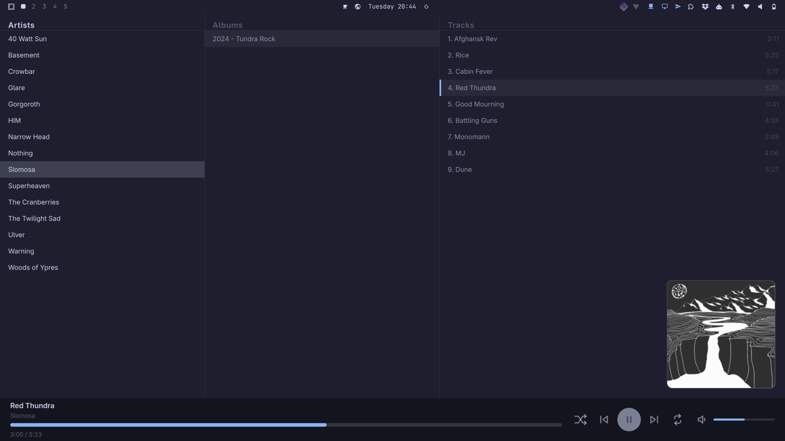
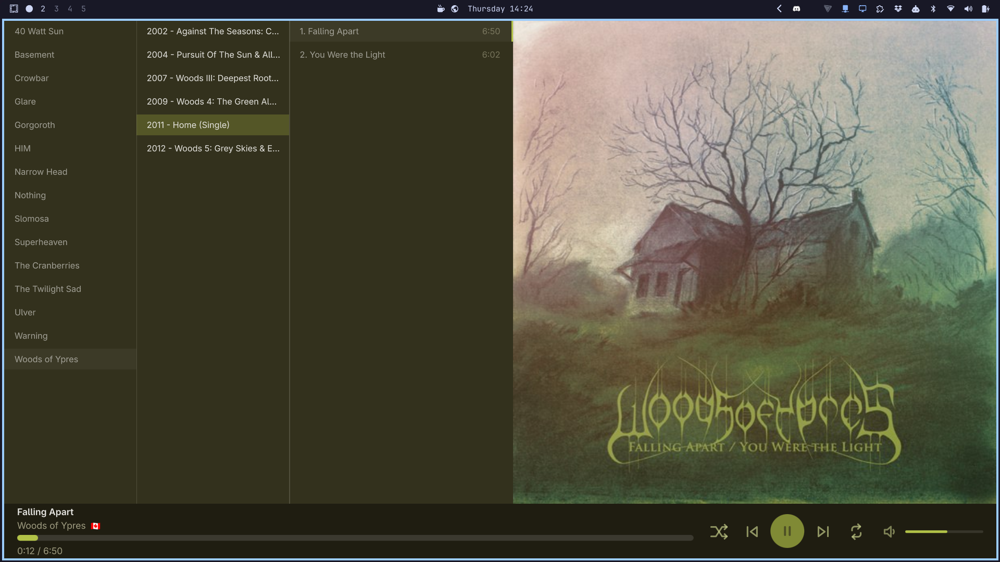

# GrimPlayer

An MPD browser for the [Omarchy](https://omarchy.org) shell: artist, album and
track panes with cover art and a now-playing strip, written as a Quickshell
plugin. It talks to MPD over its Unix socket and stays in sync by push, so
nothing polls.



With **Adaptive colours** on, the panel follows the playing album's sleeve:



## What it does

- **Simple, minimal, three-pane layout** for browsing artists, albums and tracks.
- **Album-focused** — plays albums locally and offline with no queue management or saved playlists.
- **Cover art** — finds covers in the album folder, falls back to embedded art (extracted with `ffmpeg` and cached), and can optionally fetch missing covers online.
- **Responsive artwork** — the cover gets its own pane on a window with room for it, and folds back to a small floating corner cover when the window is small. `Cover pane` pins that on or off, or leaves it to `auto`, which measures the window against the monitor it is on; `Pane above` tunes the window size floor the pane is kept to.
- **Adaptive colours** — optionally matches the panel's colors to the playing album.
- **A strip that gives way** — on a narrow window the now-playing strip tightens its margins and shortens the volume track, then drops the track and keeps the speaker, so the title and the transport never squeeze each other.
- **Type-to-find** — jump to matching rows by typing, with the readout placed above the now-playing strip (where transport changes appear) or centred in the middle of the window, at a size of your choosing. In the tracks pane a number jumps to that track.
- **Quiet track numbers** — the tracks pane writes `01.` or `01 -` before each title, and can hold the number back in the same muted ink as the durations.
- **Lyrics** (`Alt` + `L`) — embedded lyrics, a `.lrc`/`.txt` beside the track, or the shared `~/.lyrics` cache, read before anything is fetched; synced lyrics highlight and follow the playing line.
- **Karaoke** (`Alt` + `K`) — turns the open player into a lyrics-only view: large centred text, the current line bold, everything else out of the way.
- **Album view** (`Alt` + `A`) — a now-playing surface rather than a browser: the album's titles in large centred type, every track but the playing one held back, and the cover beside them. A small preview of the next album's cover sits above the bar. `Esc` returns to the browser.
- **Extensive settings** (`Alt` + `S`) — layout, fonts, spacing, cover art, lyrics, themes and optional features.
- **Vim motions (optional)** — `j` `k` `h` `l` `g` `G` alongside arrows; with them on, `Shift` + `h`/`l` seek.
- **Key reference** (`?`) — quick overview of keys.

## Optional features

Everything here is optional, and so are the dependencies each one needs. With
none of it installed the player still browses, plays, and shows any cover art
that sits beside the tracks. What a missing dependency costs depends on the
feature: a cover that cannot be found falls back to the placeholder, while a row
with a job of its own reports the failure there. The table says which is which.

| Feature | Needs | Without it |
| --- | --- | --- |
| Embedded cover art | `ffmpeg` | Albums whose artwork is inside the file fall back to the placeholder; sidecar and fetched art are unaffected. |
| Tag and cover editing, country flags | `mid3v2` (MP3) or `metaflac` (FLAC), and `zenity` to pick a cover file | The tag editor opens and shows what the files hold, but saving writes nothing and Browse cannot choose a cover file. |
| Look up | `python3` with [`mutagen`](https://mutagen.readthedocs.io/) and [`musicbrainzngs`](https://python-musicbrainzngs.readthedocs.io/), and network access | The Match row reports the failure; editing by hand still works. |
| Fetch covers | `python3` (standard library only) and network access | Albums with no artwork keep the placeholder. On by default; turned off under **Artwork** in the settings. |
| Fetch lyrics | `python3` (standard library only) and network access | Tracks with no lyrics on disk show “No lyrics found”. On by default; turned off under **Lyrics** in the settings, which keeps the view local-only. |

## Requirements

- Omarchy 4.x, with third-party plugin support (`omarchy plugin add`).
- [MPD](https://www.musicpd.org/) with a Unix socket. The default location is
  `~/.mpd/socket`; set `GRIM_LIBRARY_MPD_SOCKET` to point somewhere else.

Nothing else is required. The features that need extra tools or a network
connection are listed in [Optional features](#optional-features).

## Install

```bash
omarchy plugin add https://github.com/skollgrim/grimplayer.git
omarchy plugin enable skollgrim.grimplayer
```

`add` clones into `~/.config/omarchy/plugins/skollgrim.grimplayer/` and lands
the plugin disabled so you can read it first; `enable` records it in
`shell.json`. `add` confirms in a terminal — it prints what it is about to do —
while `enable` does not prompt; `omarchy plugin add --yes` skips the prompts if
you are scripting.

Optional, to get GrimPlayer in the app launcher:

```bash
install -Dm644 extras/GrimPlayer.desktop ~/.local/share/applications/GrimPlayer.desktop
```

### Opening it

The shell exposes three verbs to summon GrimPlayer:

```bash
omarchy-shell -q shell summon skollgrim.grimplayer   # open, or do nothing if open
omarchy-shell -q shell toggle skollgrim.grimplayer   # open if closed, close if open
omarchy-shell -q shell hide   skollgrim.grimplayer   # close
```

*Optional:* Add a keybinding in `~/.config/hypr/bindings.lua` to call the
`summon` command, e.g. `ALT + M`: `o.bind("ALT + M", "GrimPlayer", "omarchy-shell -q shell summon skollgrim.grimplayer")`

`summon` is the one to reach for from a launcher or a script: it is idempotent, so
binding it to a key cannot accidentally toggle the panel shut. A keybinding is
then a one-liner around whichever of the three you prefer.

## Keys

| Key | Action |
| --- | --- |
| `↑` `↓` | Change row |
| `←` `→` | Change pane |
| any letter, digit or `-` | Typeahead; a number jumps to that track in the tracks pane |
| `Enter` | Play the artist, album or track under the caret |
| `Space` | Play / pause |
| `Ctrl` + `←` `→` | Previous / next track |
| `Ctrl` + `↑` `↓` | Volume − / + 5% |
| `Ctrl` + `M` | Mute / unmute |
| `Ctrl` + `S` | Shuffle: off → album → artist → library |
| `Ctrl` + `R` | Repeat: off → album → song |
| `Shift` + `←` `→` | Seek ∓ 5 s |
| `j` `k` | Change row *(Vim keys on)* |
| `h` `l` | Change pane *(Vim keys on)* |
| `Shift` + `h` `l` | Seek ∓ 5 s *(Vim keys on)* |
| `g` / `G` | First / last row *(Vim keys on)* |
| `Alt` + `S` | Settings card |
| `Alt` + `T` | Tag editor |
| `Alt` + `L` | Lyrics view (toggle) |
| `Alt` + `K` | Karaoke view (toggle) |
| `Alt` + `A` | Album view (toggle) |
| `Alt` + `C` | Cycle the cover for the current view |
| `Alt` + `O` | Karaoke background opacity |
| `Alt` + `=` / `-` | Text size for the current view |
| `Alt` + `Shift` + `=` / `-` | Cover size in the browser and lyrics view |
| Right-click a row | Open the folder behind it, or its file selected in the file manager |
| `?` | Key reference |

`Alt` + `L`, `Alt` + `K` and `Alt` + `A` each switch straight to their view from
either of the other two, and pressing the key of the view already showing returns
to the browser. Closing the panel keeps the view, so the next summon comes back
to lyrics, karaoke or album view rather than resetting to the browser.

The Ctrl keys and the Alt cover and size keys say what they did: a mode change,
a volume step or a new size flashes a one-line readout above the strip — or, in
karaoke, in the margin under the words — and it fades after a moment. The strip's
own buttons and slider are hidden in karaoke, so without it a shuffle or repeat
change would be silent there. The readout has its own text size (Text & scale →
Transport readout), so it can be made easier to catch at a glance without
touching the lists.

Shuffle has three pools, not one: the playing album, the artist, or the whole
library. `Ctrl` + `S` (or the shuffle button) cycles off → album → artist →
library, and a small `Alb`, `Art` or `Lib` sits above the button naming the pool.
Repeat's badge uses `A` for album and `S` for song the same way. The two modes
are mostly independent, with one exception each way: choosing repeat album
narrows the shuffle to album, because the queue is about to hold one album, and
choosing a wider shuffle pool steps out of repeat album for the same reason. The
readout names the change that came along with the key you pressed.

In the settings card: arrows or `hjkl` move — up/down walks the visible tab and
wraps at its ends, left/right crosses the tabs — `Enter` (or `Space`) toggles a
switch or opens a slider, `←` `→` (or `h` `l`) adjust the open slider, `g` / `G`
jump to the first or last setting, `Backspace` resets the row under the caret, `R`
resets everything, `?` switches to the key reference, `Esc` steps back out and `Q`
closes. The visible tab follows the caret, and each tab remembers the row you
left it on.

The card is cut into columns by topic — the list and what plays it, the panes and
their rules, the text and its scale, the cover art, the lyric choices both
surfaces share, the reading view's own, and karaoke's own surface — so a slider
and a switch sit together where their subject says they should, and a setting is
always in the same place. A setting that only matters while another is on — a
cover border's width, the artwork pane's position — stays on the card but is
greyed, sitting directly beneath the setting it waits on, so the row above is why
it is greyed and you never edit a value nothing reads. Its value is kept for when
the parent comes back.

In the lyrics view: `j` / `k` or `↑` / `↓` scroll a line, `PgUp` / `PgDn` a page,
`Home` / `End` jump to the top or bottom, `Space` plays and pauses, and a click on
a timed line seeks to it. `Esc` or `Q` closes the view — or leaves karaoke for the
browser; from karaoke, `Alt` + `L` steps back to the reading view instead.
Scrolling by hand pauses following for the wait set under **Resume after
scroll**; with that set to **Never** the view stays where you put it until the
track changes.

In the key reference: it lists the browser keys and how to reach each screen;
`j` / `k`, the arrows, `PgUp` / `PgDn`, `Home` / `End` and `Space` scroll it,
and `Esc`, `Q` or `?` closes it.

In the tag editor: `Enter`, the **Save** button and **Close** all do the same
thing (see below); `Esc` or **Cancel** discards and closes at once, with no
confirmation, because nothing is written until Save; `Tab` / `↑` `↓` move
through the fields, the file name row, the match row, the cover row and the two
decision buttons, wrapping at both ends. On the file name row, `←` `→` move
between From name and Rename; on the match row, `←` `→` move between Look up,
Prev, Next and Revert; on the cover row, `←` `→` move between Browse and Remove.
`L` runs a lookup from the card itself and `F` reads the file's own name into
the fields — a field that has focus just types the letter.

### Tag editor

`Alt` + `T` edits the tags of whatever the caret is on: one track in the tracks
pane, the whole album in the albums pane, or everything by that artist in the
artists pane. The panel must be open for the keybinding to work.

Each field shows what the selected tracks agree on. A field they disagree about
reads `multiple` and is **not written** — so retagging a genre across an album
cannot quietly flatten the track titles with it. Change it and that one value is
written to every selected track; clear it and the tag is removed. Opening the
editor and saving without touching anything writes nothing. Once a save lands,
the button reads **Close** until you edit again — so the same key finishes the
session rather than answering “Nothing changed”.

Fields: Title, Artist, Album artist, Album, Track, Disc, Year, Genre, Country.

Under the title the card names what it is about to write: the file's path for a
lone track, or the deepest folder the whole selection shares when several tracks
are open. Paths are shown relative to the music library when they live inside it,
and a cue album's virtual tracks name the cue sheet, the file that really exists.
The line is elided in the middle, so the filename stays readable.

Below the fields, reading as one more field, is a **File name** row. **From name**
reads the file's own name into Track, Disc and Title, so a library that arrived
as `01 - Title.flac` can be tagged without retyping it. `01 - Title`,
`01. Title`, `01_Title`, `01 Title`, `1-02 Title` and
`Artist - Album - 01 Title` are all understood, and the artist/album prefix is
left in the name rather than guessed into a tag. A name with dashes but no
number is left alone, because `Artist - Title` and `Album - Title` cannot be
told apart, and a value that already matches its tag is not staged. Reading a
name is a staged edit like a lookup: untouched until Save, undoable with
**Revert**, and a lone track's values also appear in the fields.

**Rename** is the other direction: it writes the staged tags and then moves each
selected file to `NN - Title.ext`, the track padded to two digits (or three when
the album numbers past 99), keeping its own extension. A missing Title or Track
falls back to what the current name says, so a well-named but untagged album can
be normalized in one pass; with no title anywhere the file is left alone rather
than named `01 - .flac`. An existing file is never overwritten — a name already
taken is skipped and reported — and a cue album's virtual tracks are skipped as
everywhere else. Once a file has moved the editor closes, because the paths it
was opened on no longer exist, and MPD is told to update so the browser follows
the new names.

Below the file name row is a **Match** row with a **Look up** button:
it searches [MusicBrainz](https://musicbrainz.org/) for the selected album and
pre-fills everything from the best match — Artist, Album artist, Album, Year and
Country, each track's own Title, Track and Disc, and a front cover. The cover is
not taken from MusicBrainz: the two stores that serve clean, square, high-res
sleeves (iTunes, then Deezer) are asked first, at up to 1200px, and the
[Cover Art Archive](https://coverartarchive.org/) is used only when neither has
a confident match. The status line says which source won and how big it is. It
writes nothing on its own: the match is shown so it can be reviewed, corrected
by hand, or stepped past with **Next** before Save commits it. Every field the
match moved shows a muted `was:` line with what it held before, so the change
can be judged rather than trusted, and a **Revert** button beside the match
buttons hands the selection back — every field and the cover — to what it held
before the first lookup. Revert keeps the candidates, so **Next** can still
re-apply a match afterwards.

The search uses the selection's own Artist and Album tags; for a folder that has
none, it falls back to the `Artist/Album` directory names. When several pressings
match, the folder's year and track count rank them, and **Prev** /
**Next** walk the candidates — each step re-fetches only that release, so a
wrong first guess costs one click rather than a retype. It is offered for a single
album only: a selection spanning several albums (an artist's whole shelf) is
refused rather than guessed at. Look up needs `python3` with `mutagen` and
`musicbrainzngs` (see Requirements); without them the row reports the failure and
the editor is otherwise unchanged.

Below the match row is a **Cover art** row: a preview of the
selection's cover, a **Browse…** button that opens a file chooser in the album
folder (so the covers already beside the tracks are the first thing on offer), and
a **Remove** button. The preview is drawn at a size you can actually judge, and
the picture's own resolution sits underneath it, so a full-size sleeve is
distinguishable from an upscaled thumbnail before it is embedded. Saving a chosen
image embeds it into every selected file;
removing strips the embedded picture back out. The album folder itself is left
alone either way — no `cover.jpg` is written and an existing one is not touched —
so the embedded copy is what travels with the files, and the cached extraction is
dropped so the player re-reads what the files now hold.

Because the folder is left alone, an album that already has a sidecar image would
otherwise keep showing it. The editor therefore remembers the decision per album
(in `~/.local/state/skollgrim.grimplayer/coveroverrides.json`): a set cover tells
the player to show the embedded picture and ignore the sidecar beside the tracks,
and a removal tells it to show no art at all rather than falling back to the
sidecar or the stores. The choice survives a restart and is undone by deleting
that album's entry from the file (or the file itself).

Country takes a two-letter ISO code (`SE`, `FI`, `US`) rather than a name, and
the flag shown beside the field is the one the now-playing strip will show.
Releases tagged Worldwide (`XW`, which MusicBrainz uses when there is no single
territory) get a globe instead, since there is no flag to draw.

The UK home nations have no two-letter code of their own — ISO 3166-1 gives the
UK a single `GB` — so they are accepted as ISO 3166-2 subdivisions, which is what
the subdivision flag emoji are keyed on: `GB-ENG`, `GB-SCT` and `GB-WLS`.
Northern Ireland (`GB-NIR`) is left out, because the emoji font has no glyph for
it and it renders as an empty white flag.

MPD cannot write tags — it treats the library as read-only — so the files are
edited in place by `mid3v2` and `metaflac`, one file at a time. Both rewrite only
the tag block and leave the audio alone. Nothing else is discovered at runtime
and there is no re-encoding fallback.

Some things to know:

- **Cue sheets are skipped.** MPD presents a cue album as one virtual song per
  track, at a path (`<album>.cue/track0001`) that does not exist on disk. Their
  per-track tags live inside the cue sheet, which these tools cannot open, so
  they are reported as skipped rather than guessed at.
- **Track numbers count through the album.** A multi-disc release is numbered
  straight on (disc 2 starts where disc 1 stopped) while the Disc tag still
  records which disc a track is on, so the tracks pane needs no disc prefix. A
  vinyl side's printed position (`A1`, `B2`) is written as the number it stands
  for, since a tag cannot hold a side letter.
- **Country is not a tag MPD reports.** MPD's song model has no country field at
  all, so the value is read from the file directly — once per album, then kept in
  `~/.local/state/skollgrim.grimplayer/countries.json`, including when the answer is
  "no country here". Editing it through GrimPlayer updates that cache.
- The tag is Picard's, which is what most libraries are already tagged with:
  `MusicBrainz Album Release Country` on MP3, and both
  `MUSICBRAINZ_ALBUMRELEASECOUNTRY` and `RELEASECOUNTRY` on FLAC.

### Lyrics

`Alt` + `L` covers the panes area with the lyrics for the playing track. Nothing
is fetched while the view is closed, and nothing is fetched for a track whose
lyrics are already on disk: the player reads embedded lyrics, a `.lrc` or `.txt`
beside the track, and the shared `~/.lyrics` cache first, and only then starts the
bundled `fetch_lyrics.py` — which asks [lrclib](https://lrclib.net/) and writes
what it finds back to that cache. Turning **Fetch lyrics** off under the
**Lyrics** tab keeps even that last step local-only, so the view never opens a
socket.

Synced lyrics (`.lrc`, or the `syncedLyrics` field lrclib returns) carry a time on
each line. The current line is marked and, under the default **Follow along**
setting, kept in the middle of the view as playback moves; the lines around it
fade so the reading line stands out. A manual scroll pauses following for the
configured wait rather than fighting the wheel. Plain lyrics still display, just
without a time to mark or seek to; clicking a timed line seeks to it.

The lyric settings are split across three tabs. **Lyrics** holds the choices both
surfaces share: line spacing, how far the lines around the current one dim, how
long a manual scroll holds before following resumes, the global sync offset,
click-to-seek, and fetching. **Lyrics view** holds the reading view's own:
alignment, text size (an offset from the theme, so it tracks the rest of the
panel), whether the title and artist sit above the text, how following behaves,
the width of the reading column, and whether the cover sits beside the lyrics.
**Karaoke** holds karaoke's own text size, its track header, and the cover's
placement — beside the lyrics, behind them as a low-opacity background, or
nowhere — with the background opacity. Every default reproduces the views as
they looked before the tabs existed.

`Alt` + `K` turns the open player into karaoke: the lists and the now-playing
strip are hidden, the text is set large and centred, and the current line is
always marked and followed. The track header sits above the scrolling words and
stays put as they move; **Track info** chooses whether it shows the track, the
track and artist, those plus the album, or nothing. The **Cover** setting puts a
full-size cover to the right of the lyrics, matching the artwork pane at full
size, which shifts the text left into the room that leaves; in **Background** it
lays the cover over the whole view at the chosen opacity with the lyrics on top,
and **Hidden** leaves the text centred on its own. It is a view of the same
window, toggled exactly like `Alt` + `L` — press it again to go back to the
browser, or press `Alt` + `L` to step straight to the reading view. The shared
reading settings still apply where they make sense — spacing, dimming, resume,
offset, click-to-seek — but karaoke has its own text size, track header and
cover, and alignment and following are fixed by karaoke itself. `Esc` or `Q`
also returns to the browser. The view is remembered: closing and reopening the
player comes back to karaoke, as it does to the lyrics and album views.

The highlight stays readable on light sleeves. Adaptive colours guarantee the
accent at least 3:1 against the panel, measured against the ground actually
derived from the cover rather than an assumed one; on a near-white cover that
still reads as a faint tint, so the current line is also set in a heavier weight,
and the accent is used for it only when it clears 4.5:1 against the background;
otherwise the line takes the panel's ordinary foreground ink.

### Album view

`Alt` + `A` shows the record that is playing as a now-playing surface rather than
a browser: the album's titles in large centred type, every track but the playing
one held back, and the cover beside them. Entering the view snaps the browser's
selection to the playing album, and a track change moves it along, so the same
keys work there — `↑`/`↓` or `j`/`k` to move, typing to jump, `Enter` to play the
row under the caret. The cover is a square capped at half the window width and
held back on a narrow window so the titles keep a readable measure; the
cover-pane margin, position and border settings apply as they do in the browser.
`Alt` + `A` again, or `Esc`, returns to the browser, and `Alt` + `L` or
`Alt` + `K` switches straight to the lyrics or karaoke view. Clicking a title
plays it at once, rather than selecting it and waiting for `Enter`. Nothing
playing leaves the current selection in place, so the view still has an album to
show. The record is named in a quiet caption above the titles — album, artist,
year and running time, read from the album's tags — and the `Album caption`
setting turns that line off for a surface of titles alone. Hovering a title
lights it exactly as the caret does, but the highlight follows a live pointer: a
key press hides the cursor and takes the highlight with it, and moving the
pointer again brings both back.

Above the now-playing bar, tucked into the lower-left corner, sits a small cover
for the album that follows this one in the library, captioned **Up next**. It is
a glance rather than a control: it takes no input, and it disappears when there
is no next album, when shuffle or repeat is on (neither walks the library in
tree order), and when **Up next cover** under **Artwork** is off.

The mouse works too: click a row in the browser to select it and move the caret
into the next pane (playback still needs `Enter`; in album view a click plays the
track at once), click a setting to change it, drag the seek bar or the volume
slider, click the volume icon to mute. Right-click a row — in the browser or in
album view — to open what is behind it: an artist's folder, an album's folder, or
a track's file selected in the file manager. The file manager is Flea on Omarchy,
with Nautilus, the desktop `FileManager1` service and `xdg-open` as fallbacks.

## Notes and limitations

- **Embedded artwork needs `ffmpeg`, and is always the second choice.** MPD can
  serve it (`albumart`), but this plugin talks to MPD over a text socket, and a
  JPEG does not survive that decoding, so the file is handed to `ffmpeg` instead.
  Without it, an album with no sidecar image keeps the placeholder exactly as
  before. Where both exist, the sidecar wins — see
  [`CoverArt.qml`](CoverArt.qml) for why. The one exception is an album whose
  cover was set or removed through the tag editor: that decision is remembered,
  and the embedded picture (or nothing) wins there until the entry is deleted. For a cue album the audio is a single
  file beside the cue whose name MPD never reports, so `ffmpeg` is pointed at
  the cue's own stem with the usual rip extensions tried in turn; a cue whose
  audio is named differently will not have its embedded art found.
- **Fetched covers are the last choice and are never written into the music.** A
  downloaded cover is cached as `covers/<hash>.online.jpg`, beside the
  `<hash>.jpg` the `ffmpeg` extraction writes, and is used only once the sidecars
  and the embedded picture have both come up empty — so a store's guess never
  stands in for what the file actually holds, and clearing the embedded art lets
  the download show again. Nothing is written to the album folder and no sidecar
  is created. Removing a cover by hand hides the download for that album, so a
  deliberate removal stays empty rather than being filled back in; the decision is
  remembered — see the tag editor's cover overrides above — so a shell restart
  keeps it empty too, until that album's entry is deleted from
  `coveroverrides.json`. Deleting the file under
  `~/.local/state/skollgrim.grimplayer/covers/` forces a fresh lookup. Asking the
  stores means telling them the artist and album name — the same query iTunes and
  Deezer's own search boxes send — so this is on by default but can be turned off
  for a library that should stay offline.
- **The music directory** is assumed to be `~/Music`, honouring `XDG_MUSIC_DIR`
  when it is exported, which should match MPD's `music_directory`.
- **Typeahead accepts ASCII letters and digits plus `æøåÆØÅ` and `-`.** Widen the
  regex at the bottom of the key handler in `GrimPlayer.qml` for other scripts.
- **Album repeat is client-side**, so there is a fraction of a second of silence
  at the album boundary.
- **No stored playlists and no queue view**, by design: the queue is the
  current album from its first track, then the rest of the library from there.
  Starting mid-album keeps the earlier tracks in front of you so `Ctrl` + `←`
  can walk back to the top of the record.

## Development

The plugin is two entry points: `GrimPlayerMpd.qml` (the service — socket,
protocol, library tree, queue policy) and `GrimPlayer.qml` (the panel). The
socket has to outlive the panel, hence `kinds: ["service", "panel"]`: a service
is created at shell start and lives for the session whatever the panel does. The
manifest also sets `keepLoaded`, which keeps the panel mounted while it is closed
so that opening it again comes back to the same artist, album and scroll
position rather than re-summoning from the top.

Adaptive colouring is two more files: [`GrimTheme.qml`](GrimTheme.qml) holds the
panel's own colour tokens and folds a cover's palette into them, and
[`Palette.js`](Palette.js) is the pure colour maths behind it. The shell's
`Color` singleton is global, so the panel never writes to it — it keeps this
copy instead. `CoverArt.qml`'s `ColorQuantizer` exposes the palette the panel
reads, and the derived result is cached against the resolved cover URL so a
revisited album skips both the colour pass and the derivation. That cache is
kept in `palettes.json` under the state directory, bounded to 48 entries, so a
shell restart does not make every album pay the colour pass again. It is
versioned by the rules that derived it: entries are depth-4 palettes (sixteen
clusters, repeats kept so a colour that fills the sleeve carries its weight),
and entries from an older derivation are discarded on load rather than served
as if they were the same thing.

Lightness is moved in OKLCH rather than HSL: OKLCH keeps a colour's perceived
brightness and hue while the lightness changes, where HSL's channel average
makes a darkened blue turn navy and a lightened red turn pink. Colours that fall
outside the display gamut are brought back by reducing chroma at constant
lightness and hue, not by clipping channels; the accent is then walked away from
the derived ground until it clears 3:1. The light/dark split reads the mean
cluster's OKLCH lightness, not a green-weighted luma, so a vivid pink sleeve gets
the light panel its brightness calls for while a genuinely mid-dark olive one
stays dark.

`Covers.js` and `Palette.js` are deliberately plain scripts rather than
`.pragma library`: a library is compiled once per engine and cached across
reloads, so a library edit would never be picked up, while a plain script is
recompiled with the component that imports it. `Paths.js`, `Names.js`,
`PaletteSync.js`, `Lyrics.js`, `Layout.js`, `TagFrames.js`, `TagSave.js` and
`Scroll.js` follow the same rule, keeping the lyrics parser and its timing, the
cover geometry, the tag writers' argv, the save's decisions about what is
pending and what its result means, the whole-row scroll arithmetic, and the
panel and editor's path arithmetic testable outside the shell:

```bash
./extras/test-all.sh
```

That runs `lint.sh`, every Node suite and the QML suite below. The Node suites
can also be run one at a time (`node extras/test-paths.js`, `test-names.js`,
`test-palette.js`, `test-palette-sync.js`, `test-lyrics.js`, `test-layout.js`,
`test-tag-frames.js`, `test-tag-save.js`, `test-scroll.js`).

The last line is the QML-level half: it runs `qmltestrunner` against the real
`GrimPaletteStore.qml`, `GrimTheme.qml`, `PaletteSync.js` and
`GrimPlayerConfig.qml`, with Quickshell's `FileView`/`Process` and the shell's
`qs.Commons` tokens swapped for the small stand-ins under
`extras/qmltest/stubs`. That covers the cache's hit/miss path, the JSON round
trip and its validation, the theme's delegation, the race guard that keeps a
stale quantization from being applied to or cached under the next cover, and the
settings table's schema -- every row naming a real store property, offering
rungs of that property's own type, and landing in a column. Nothing in the suite
writes to the real state directory.

Lint the QML against the shell's own module root:

```bash
./lint.sh
```

A bare `qmllint` cannot resolve `qs.Commons`, so it reports every `Color.*`,
`Style.*` and `Util.*` token as an unknown member. The script puts the shell's
modules on the import path first; the only remaining concession is the `var`
alias for `Style.font` at the top of the components that use it, because
qmllint cannot see the tokens inside that dynamic object.

Edit the files under `~/.config/omarchy/plugins/skollgrim.grimplayer/` and the
shell notices on save — but in practice a save still does not swap the running
code, and that is Omarchy's, not this plugin's. Omarchy's plugin reload finishes
by clearing the QML component cache with `Qt.clearComponentCache()`, which is not
part of the QML `Qt` object, so the guarded call never runs and a reload
re-instantiates the previously compiled QML. Until that is fixed upstream
(omarchy#6981) an edit to any plugin file — service, panel or script — needs
`omarchy restart shell` to take effect. `keepLoaded` compounds this for the
service alone: a kept service instance is not rebuilt at all, so no reload fix
short of dropping the flag can reach it, and dropping the flag gives up the warm
panel described above.

Check a manifest before pushing it out:

```bash
omarchy plugin validate ~/.config/omarchy/plugins/skollgrim.grimplayer
```

Beyond the palette suite, the plugin is verified against a live MPD: kill MPD
underneath it, restart it, add an album and confirm the tree follows.

## Licence

MIT. See [LICENSE](LICENSE).
